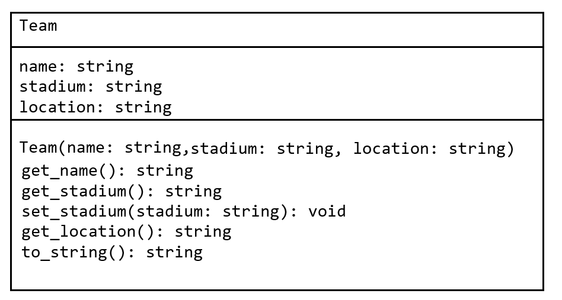

# Assignment 4 - EPL Data

## Setup

Create a new project folder or notebook called `a4`.  You will need to add the contents of [this](a4.zip) ZIP file into the project.


## Q1 - Teams & Team Table [%]

1.  Provide the code in a Python program `teams.py` to print each team name.  Use whatever file you want to do this. [%]

    ```
    Manchester City
    Manchester United
    Tottenham Hotspur
    Liverpool
    Chelsea
    Arsenal
    Burnley
    Everton
    Leicester City
    Newcastle United
    Crystal Palace
    Bournemouth
    West Ham United
    Watford
    Brighton
    Huddersfield Town
    Southampton
    Swansea City
    Stoke City
    West Bromwich
    ```

1.  Provide the code in `teamByPosition.py` to ask the user to input a  table position(rank) and then print the name of the team at that position. [%] e.g.

    ```
    Get team at position [1-20]:4
    #4. Liverpool
    ```

1.  Create a program `printTable.py` to print the team table data as shown here [%]:
    ```
    #. Team			        Played	Wins	Draws	Losses	Pts
    1. Manchester City	    38	    32	    4	    2   	100
    2. Manchester United	38	    25	    6	    7   	81
    3. Tottenham Hotspur	38	    23	    8	    7   	77
    4. Liverpool		    38	    21	    12	    5	    75
    5. Chelsea		        38	    21	    7	    10  	70
    6. Arsenal		        38	    19	    6	    13  	63
    7. Burnley		        38	    14	    12	    12  	54
    8. Everton		        38	    13	    10	    15  	49
    9. Leicester City	    38	    12	    11	    15  	47
    10. Newcastle United	38	    12	    8	    18  	44
    11. Crystal Palace	    38	    11	    11	    16  	44
    12. Bournemouth		    38	    11	    11	    16  	44
    13. West Ham United	    38	    10	    12	    16  	42
    14. Watford		        38	    11	    8	    19  	41
    15. Brighton		    38	    9	    13	    16  	40
    16. Huddersfield Town	38	    9	    10	    19     	37
    17. Southampton		    38	    7	    15	    16  	36
    18. Swansea City	    38	    8	    9	    21  	33
    19. Stoke City		    38	    7	    12	    19  	33
    20. West Bromwich	    38	    6	    13	    19  	31
    ```
1.  Provide the code in `teamTableInfo.py` to allow the user to enter a team name and then print table infor as shown here: [%]

    ```
    Enter team name:Liverpool
    Liverpool Won 21, Drew 12 & Lost 5
    75 points (Pts/match=1.97; WinRate=0.66)
    ```

## Q2 - Summary Info. [%]

1.  Provide the code in `viewSummary.py` that reads `EPL-summary.json` and outputs [%]:
    ```
    {'matches': 380, 'totalGoals': 1018, 'totalHgoals': 582, 'totalAgoals': 436, 'avgGoals': 2.68, 'totalxG': 1008.92, 'avgxG': 2.66, 'minxG': 0.65, 'maxxG': 6.63}
    No. of Matches: 380
    Total Goals (xGoals): 1018 (1008.92)
    Average Goals (xGoals) per match: 2.68 (2.66)
    ```

1. Provide the code in `updateSummary.py` to read the contents of `EPL-summary.json` and update the minxG and maxxG values to 0.5 and 7.0 respectively.  The updated file should look like this when executed [%]:

    ```json
    {
        "matches": 380,
        "totalGoals": 1018,
        "totalHgoals": 582,
        "totalAgoals": 436,
        "avgGoals": 2.68,
        "totalxG": 1008.92,
        "avgxG": 2.66,
        "minxG": 0.5,
        "maxxG": 7.0
    }
    ```

## Q3 - Matches [%]

1. Provide the code in `matchesByTeam.py` to get the user to input a team name, then print the match results for that team with some match summary data.[%]  e.g.

    ```
    Input team:Liverpool

    [7120] 2017-08-12 Watford 3-3 Liverpool
    [7134] 2017-08-19 Liverpool 1-0 Crystal Palace
    [7148] 2017-08-27 Liverpool 4-0 Arsenal
    [7149] 2017-09-09 Manchester City 5-0 Liverpool
    [7162] 2017-09-16 Liverpool 1-1 Burnley
    [7176] 2017-09-23 Leicester 2-3 Liverpool
    [7188] 2017-10-01 Newcastle United 1-1 Liverpool
    [7193] 2017-10-14 Liverpool 0-0 Manchester United
    [7207] 2017-10-22 Tottenham 4-1 Liverpool
    [7217] 2017-10-28 Liverpool 3-0 Huddersfield
    [7227] 2017-11-04 West Ham 1-4 Liverpool
    [7231] 2017-11-18 Liverpool 3-0 Southampton
    [7244] 2017-11-25 Liverpool 1-1 Chelsea
    [7258] 2017-11-29 Stoke 0-3 Liverpool
    [7268] 2017-12-02 Brighton 1-5 Liverpool
    [7275] 2017-12-10 Liverpool 1-1 Everton
    [7287] 2017-12-13 Liverpool 0-0 West Bromwich
    [7290] 2017-12-17 Bournemouth 0-4 Liverpool
    [7301] 2017-12-22 Arsenal 3-3 Liverpool
    [7313] 2017-12-26 Liverpool 5-0 Swansea
    [7323] 2017-12-30 Liverpool 2-1 Leicester
    [7332] 2018-01-01 Burnley 1-2 Liverpool
    [7343] 2018-01-14 Liverpool 4-3 Manchester City
    [7357] 2018-01-22 Swansea 1-0 Liverpool
    [7359] 2018-01-30 Huddersfield 0-3 Liverpool
    [7375] 2018-02-04 Liverpool 2-2 Tottenham
    [7384] 2018-02-11 Southampton 0-2 Liverpool
    [7395] 2018-02-24 Liverpool 4-1 West Ham
    [7403] 2018-03-03 Liverpool 2-0 Newcastle United
    [7414] 2018-03-10 Manchester United 2-1 Liverpool
    [7423] 2018-03-17 Liverpool 5-0 Watford
    [7432] 2018-03-31 Crystal Palace 1-2 Liverpool
    [7443] 2018-04-07 Everton 0-0 Liverpool
    [7452] 2018-04-14 Liverpool 3-0 Bournemouth
    [7468] 2018-04-21 West Bromwich 2-2 Liverpool
    [7472] 2018-04-28 Liverpool 0-0 Stoke
    [7485] 2018-05-06 Chelsea 1-0 Liverpool
    [7495] 2018-05-13 Liverpool 4-0 Brighton
    *********************************************************************************
    Liverpool Played 38 matches - Won 21, Drew 12 & Lost 5
    75 points (Pts/match=1.97; WinRate=0.658)
    ```

1. Provide the code in `updateMatch.py` to get the user to input a match ID, then print the match result and allow the user to input a new score for each team.  Then new score input should be updated in the `EPL-matches.json` match results file. [%]  e.g.

    ```
    Input match ID:7120

    [7120] 2017-08-12 Watford 3-3 Liverpool
    ** Update Match Score **
    Watford:3
    Liverpool:3
    [7120] 2017-08-12 Watford 3-3 Liverpool
    ** Match file (EPL-matches.json) UPDATED **
    ```
    If an invalid match id is input display a message to say so.

## Q4 - Create Summary [%]

1. Create a program `createSummary.py` that reads the match data from `EPL-matches.json` and outputs the following match statistics [%]:

    ```
    ** Match Summary **
    {
        "matches": 380,
        "totalGoals": 1018,
        "totalHgoals": 582,
        "totalAgoals": 436,
        "avgGoals": 2.68,
        "totalxG": 1008.92,
        "avgxG": 2.66,
        "minxG": 0.65,
        "maxG": 6.63
    }
    ```
    Do not read the data from `EPL-summary.json`.   
    You only need to output this data, no need to create/update any file.


## Q5 - ``Team`` class [%]

1. Provide the code in ``Team.py`` that implements the ``Team`` class as shown in the class diagram below [%]:
   
    

1. Test you've implemented the ``Team`` class correctly by running this code [%]:
   ```python
    team = Team("Liverpool","Anfield","Liverpool")
    print(team.to_string())
    print(team.get_name())
    print(team.get_stadium())
    print(team.get_location())
    print(team.set_stadium("MassMutual Anfield"))
    print(team.get_stadium())
    print(team.to_string())
    ```

    You should see this output:

    ```
    [Team: name = Liverpool, stadium = Anfield, location = Liverpool]
    Liverpool
    Anfield
    Liverpool
    MassMutual Anfield
    [Team: name = Liverpool, stadium = MassMutual Anfield, location = Liverpool]
    ```


## Submission Details

The deadline for electronic submissions is **noon Friday 27th November 2026**. Submit your code via the link on BlackBoard.

### A note on plagiarism and cheating

If any of the code submitted by you is deemed copied from or by someone else it will be formally reported to the Head of School of Science and a Disciplinary Committee will be convened to deal with this issue. You do not want that to happen!!

Never copy code from someone else or another source. Never give your code to someone else. Keep your code safely in your own possession. Plagiarism and cheating are very serious academic offenses with serious consequences for your future academic studies and work opportunities. Under current guidelines all students involved in plagiarism or cheating must be reported to the Head of School where a Disciplinary Committee will deal with the issue.

Do not use any generative AI tools!!!!

Final grades are subject to a possible code review of your solutions.  A code review will include checks for the following:  
- readability 
- duplication of code 
- variable naming 
- code performance 
- authenticity 
- hard coding 
- etc. 
